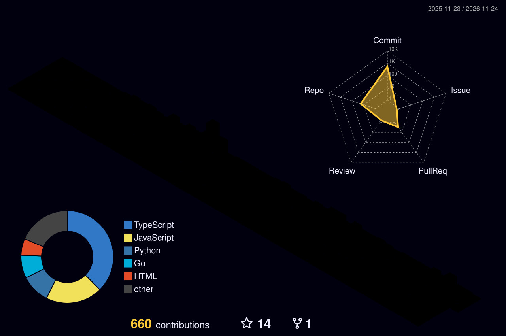

<div align="center">


<a href="https://git.io/typing-svg">
  
</a>

<br/><br/>

<a href="https://www.linkedin.com/in/arshal-rejith17/"></a>
<a href="https://leetcode.com/u/arshalrejith/"></a>
<a href="mailto:iamarshalrejith@gmail.com"></a>
<a href="https://wedcraft.in"></a>

<br/>


</div>

<br/>

## About Me

```yaml
name: Arshal Rejith S
role: Software Engineer | Full Stack Developer | AI Engineer

education: B.Tech CSE (IoT) @ Shiv Nadar University, Chennai
graduation: 2027
location: Chennai, India | Open to opportunities

what_i_do:
  - Build and ship full-stack products from idea to production
  - Design backend systems, APIs, and distributed applications
  - Explore practical applications of Generative AI and RAG
  - Turn real-world problems into usable software

featured_work:
  - WedCraft: Independently built and launched a SaaS product
  - GoOrbit: Built a peer-to-peer file storage system in Go
  - DownX: Developed an AI-powered inclusive learning platform
  - StayAI: Built a RAG-powered hospitality assistant during my internship

currently_exploring:
  - Distributed Systems & System Design
  - Go and Backend Engineering
  - LLM Applications, RAG & Agentic Workflows
  - Building scalable software products

mindset: >
  I enjoy understanding how things work under the hood,
  building things from scratch, and shipping software
  that solves actual problems.
```

<br/>


## Featured Projects

<table>
<tr>
<td width="50%" valign="top">

<h3>
  <a href="https://wedcraft.in">💍 WedCraft</a>
</h3>

<strong>Production SaaS · Solo Developer</strong>

<p>
  Built and launched a full-stack wedding invitation SaaS platform,
  enabling users to create personalized digital invitations,
  manage RSVPs, and handle payments.
</p>

<strong>Key Engineering Work</strong>
<ul>
  <li>Designed and developed 23+ customizable invitation templates.</li>
  <li>Implemented JWT authentication and Google OAuth.</li>
  <li>Integrated Razorpay payments with HMAC signature verification.</li>
  <li>Built RSVP management, QR codes, and an admin dashboard.</li>
  <li>Developed subscription-based monetization workflows.</li>
</ul>

<strong>Tech Stack</strong>
<p>
  <code>Next.js 15</code>
  <code>TypeScript</code>
  <code>MongoDB</code>
  <code>Razorpay</code>
  <code>Cloudinary</code>
</p>

<p>
  <a href="https://wedcraft.in">🌐 Live Product</a> •
  <a href="https://github.com/iamarshalrejith/WedCraft">📂 Source Code</a>
</p>

</td>

<td width="50%" valign="top">

<h3>
  <a href="https://github.com/iamarshalrejith/GoOrbit">🌐 GoOrbit</a>
</h3>

<strong>Distributed Systems · Peer-to-Peer Storage</strong>

<p>
  Engineered a decentralized peer-to-peer file storage system
  in Go, focusing on network communication, concurrent execution,
  content-addressable storage, and secure file handling.
</p>

<strong>Key Engineering Work</strong>
<ul>
  <li>Implemented custom TCP-based peer communication.</li>
  <li>Built peer discovery and RPC-based communication.</li>
  <li>Designed content-addressable storage using SHA-1 hashing.</li>
  <li>Used goroutines, channels, and mutexes for concurrency.</li>
  <li>Integrated AES-CTR encryption for file protection.</li>
</ul>

<strong>Tech Stack</strong>
<p>
  <code>Go</code>
  <code>TCP</code>
  <code>RPC</code>
  <code>Goroutines</code>
  <code>AES</code>
</p>

<p>
  <a href="https://github.com/iamarshalrejith/GoOrbit">📂 Source Code</a>
</p>

</td>
</tr>

<tr>
<td width="50%" valign="top">

<h3>
  <a href="https://github.com/iamarshalrejith/StayAI">🤖 StayAI</a>
</h3>

<strong>AI Engineering · Infosys Springboard Internship</strong>

<p>
  Developed an AI-powered hospitality assistant that answers
  guest queries using Retrieval-Augmented Generation (RAG)
  and multi-agent orchestration.
</p>

<strong>Key Engineering Work</strong>
<ul>
  <li>Implemented document-based knowledge retrieval using RAG.</li>
  <li>Built multi-agent workflows using CrewAI.</li>
  <li>Integrated LangChain and Groq for LLM-powered responses.</li>
  <li>Used ChromaDB for vector-based knowledge retrieval.</li>
  <li>Developed API and interactive application layers.</li>
</ul>

<strong>Results</strong>
<p>
  Reported 35% reduction in query resolution time and
  90%+ accuracy in testing.
</p>

<strong>Tech Stack</strong>
<p>
  <code>Python</code>
  <code>LangChain</code>
  <code>CrewAI</code>
  <code>Groq</code>
  <code>ChromaDB</code>
  <code>FastAPI</code>
</p>

<p>
  <a href="https://github.com/iamarshalrejith/StayAI">📂 Source Code</a>
</p>

</td>

<td width="50%" valign="top">

<h3>
  <a href="https://github.com/iamarshalrejith/DownX">♿ DownX</a>
</h3>

<strong>AI for Accessibility · Inclusive Learning</strong>

<p>
  Developed an AI-powered inclusive learning platform
  designed for students with Down syndrome, combining
  adaptive learning experiences with real-time gesture interaction.
</p>

<strong>Key Engineering Work</strong>
<ul>
  <li>Integrated Gemini API for AI-powered adaptive content.</li>
  <li>Implemented real-time gesture interaction using MediaPipe.</li>
  <li>Used TensorFlow.js for browser-based machine learning.</li>
  <li>Developed interactive full-stack application workflows.</li>
  <li>Focused on accessible, WCAG-compliant interface design.</li>
</ul>

<strong>Tech Stack</strong>
<p>
  <code>MongoDB</code>
  <code>Express</code>
  <code>React</code>
  <code>Node.js</code>
  <code>MediaPipe</code>
  <code>TensorFlow.js</code>
  <code>Gemini API</code>
</p>

<p>
  <a href="https://github.com/iamarshalrejith/DownX">📂 Source Code</a>
</p>

</td>
</tr>
</table>


<br/>

## Tech Stack

<div align="center">

**Languages**
<br/>


**Frontend**
<br/>


**Backend & APIs**
<br/>


**Databases**
<br/>


**AI / ML**
<br/>


**Tools & Platforms**
<br/>


</div>

<br/>

## GitHub Analytics

<div align="center">
  


<br/>


<br/>

<div align="center">



</div>

</div>

<br/>

## Contribution Snake

<div align="center">

<br/>
</div>

<br/>

## Dev Quote

<div align="center">

</div>

<br/>

## Education & Certifications

- **B.Tech Computer Science Engineering — IoT Specialization**, Shiv Nadar University, Chennai *(Aug 2023 – May 2027)*
- NPTEL Affective Computing — Gold Badge
- NPTEL Programming in Java — Gold Badge
- Infosys Springboard Machine Learning Program

<br/>

## Let's Connect

<div align="center">

<a href="https://www.linkedin.com/in/arshal-rejith17/"></a>
<a href="https://leetcode.com/u/arshalrejith/"></a>
<a href="mailto:iamarshalrejith@gmail.com"></a>

<br/><br/>

</div>


